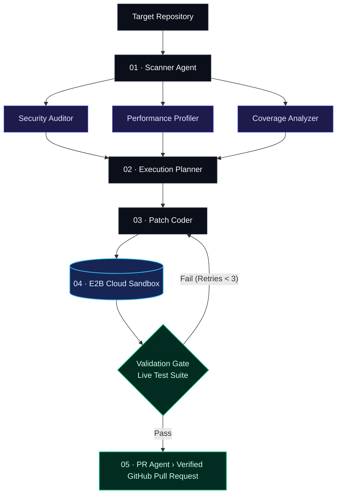

  
  
  

---

### // 01. PROFILE OVERVIEW

Software engineer specializing in **Agentic AI systems**, **state-machine orchestration**, and **fault-tolerant backend architecture**. Focused on turning non-deterministic language models into verifiable, production-grade automated workflows with sandbox isolation and deterministic validation loops.

- **Core Domains:** Multi-Agent State Systems, Autonomous Code Generation, Multi-Tenant SaaS
- **Academic Background:** B.Tech in Computer Science & Engineering (Data Science), Class of 2026

---

### // 02. ARCHITECTURE SPOTLIGHT

#### Reposition: Multi-Agent Lifecycle & Validation Loop

> **Architectural Highlights:**
> - **Parallel Audit:** Deconstructs repositories concurrently across vulnerability, bottleneck, and test-gap vectors.
> - **Zero-Trust Execution:** Patches compile and execute within isolated **E2B microVMs** against actual project test suites before any branch write.
> - **Bounded Self-Healing:** State machine retries up to 3 times with test-failure feedback, halting automatically if validation fails.

---

### // 03. FEATURED SYSTEMS

<table>
  <tr>
    <td width="50%" valign="top">
      <h4><a href="https://github.com/Aafi04/reposition">Reposition</a></h4>
      
<em>Autonomous Code Refactoring and Vulnerability Remediation Agent</em>

      <ul>
        <li><strong>LangGraph 8-Agent Pipeline:</strong> Scanner › Parallel Domain Analyzers › Execution Planner › Patch Coder › Sandbox Validator › PR Generator.</li>
        <li><strong>Deterministic Cloud Sandboxes:</strong> Patches run in isolated <strong>E2B microVMs</strong> against live test suites before reaching target branches.</li>
        <li><strong>Self-Healing Retries:</strong> Automated backoff and correction loops with strict failure boundaries to prevent broken commits.</li>
        <li><strong>Provider Agnostic:</strong> Multi-provider adapter supporting Gemini, OpenAI, Anthropic, and Groq.</li>
      </ul>
      

        
        
        
        
      

    </td>
    <td width="50%" valign="top">
      <h4><a href="https://github.com/Aafi04/SchemaDoc-AI-Hackfest-2.0-ft.-Turgon-AI">SchemaDoc AI</a></h4>
      
<em>Self-Correcting Data Dictionary and Schema Visualizer</em>

      <ul>
        <li><strong>Anti-Hallucination Gate:</strong> Cyclic LangGraph state machine verifies generated schema definitions directly against live relational metadata.</li>
        <li><strong>Scalable Data Ingestion:</strong> Tested across 3 production cloud databases handling <strong>575K+ records</strong>.</li>
        <li><strong>Interactive Graph Visuals:</strong> Interactive ER models built with ReactFlow and automated natural language SQL query synthesis.</li>
        <li><strong>Verification:</strong> 21-suite E2E test harness using <code>pytest</code> and <code>httpx</code>.</li>
      </ul>
      

        
        
        
        
      

    </td>
  </tr>
  <tr>
    <td width="50%" valign="top">
      <h4><a href="https://github.com/Aafi04/End-to-End-ERP-System">Multi-Tenant ERP Engine</a></h4>
      
<em>Enterprise Architecture Monorepo with Tiered RBAC</em>

      <ul>
        <li><strong>Tenant Isolation:</strong> Strict database isolation layers preventing cross-tenant leakage across enterprise clients.</li>
        <li><strong>Role-Based Access Control:</strong> 4-tier security matrix (Super Admin, Organization Admin, Faculty, Student).</li>
        <li><strong>Performance Monorepo:</strong> Managed via Turborepo with shared validation schemas and typed API contracts.</li>
      </ul>
      

        
        
        
        
      

    </td>
    <td width="50%" valign="top">
      <h4><a href="https://github.com/Aafi04/TechSprint-Hackathon-2026-AeroGuard">AeroGuard</a></h4>
      
<em>AQI-Aware Navigation & Exposure Reduction Engine</em>

      <ul>
        <li><strong>Air Quality Weighted Routing:</strong> Custom pathfinding engine trading minimal distance margins for reduced pollutant exposure.</li>
        <li><strong>Real-Time Feeds:</strong> Live sensor aggregation with proactive alerts for vulnerable respiratory profiles.</li>
        <li><strong>Hackathon Recognition:</strong> First Place Winner at TechSprint Hackathon 2026.</li>
      </ul>
      

        
        
        
      

    </td>
  </tr>
</table>

---

### // 04. TECHNICAL MATRIX

| Domain | Core Stack & Technologies | Architectural Patterns |
| :--- | :--- | :--- |
| **Agentic AI & LLMs** | LangGraph, LangChain, E2B Sandboxes, Gemini API, OpenAI API | Cyclic State Machines, Reflection Loops, Sandbox Execution, Anti-Hallucination Gates |
| **Backend & APIs** | FastAPI, NestJS, Node.js, Python, TypeScript | Microservices, RESTful APIs, RBAC Authorization, Monorepos |
| **Data & Storage** | PostgreSQL, MySQL, Prisma ORM, Redis, Power BI | Multi-Tenant Data Isolation, Relational Modeling, Index Optimization |
| **Frontend & Mobile** | Next.js 15, React, Flutter, Tailwind CSS | Server Components, Reactive State Graphs, Responsive Design |
| **DevOps & Infrastructure** | Docker, Git, Google Cloud Platform, Turborepo | Containerization, CI/CD Automated Pipelines, Cloud Deployment |

---

### // 05. ENGINEERING PRINCIPLES

- **Deterministic Gates for Stochastic Models:** Every LLM output that writes code or touches databases must pass through an automated validator, compiler check, or sandbox test.
- **Fail-Safe Self-Healing:** Autonomous pipelines should have explicit retry bounds, backoff logic, and graceful bailouts to prevent state poisoning.
- **Data Boundary Rigor:** Isolation boundaries (tenant IDs, RBAC claims, network barriers) must be verified at the database query level, not just the presentation layer.

---

  Mohd Aafi · Portfolio & Architecture Profile

